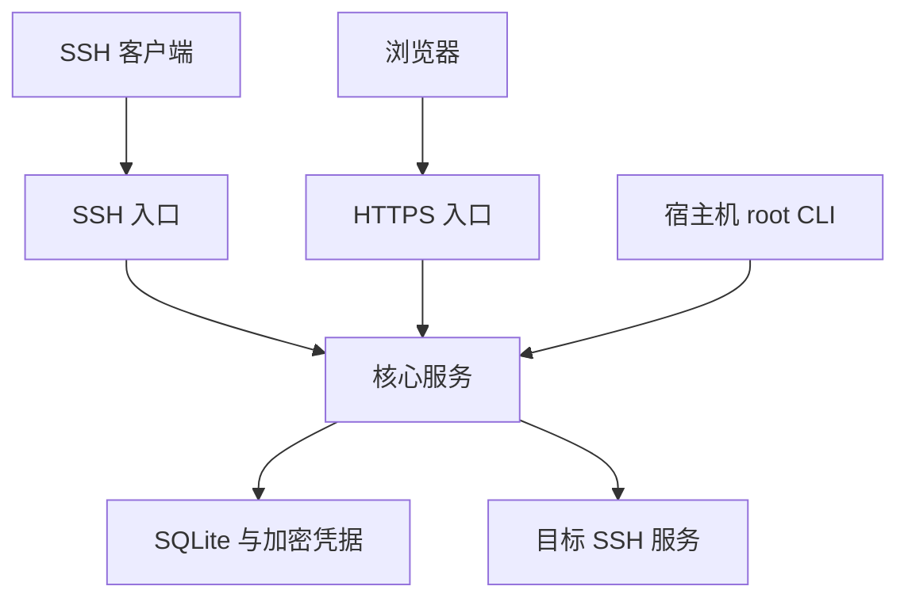

# 架构与信任边界

Gatehouse 是同一 Linux 主机上的单实例 SSH 跳板机。公开入口只有产品 SSH 与 HTTPS；核心服务通过 Unix socket 提供内部通道，不暴露远程 TCP 管理 API。

## 进程和包

| 包 | 程序 | 责任 |
| --- | --- | --- |
| gatehouse-core | ghb-core | SSH 握手认证、菜单、权限、目标连接、Web 会话、数据库和审计 |
| gatehouse-ssh | ghb-ssh | 接受外部 TCP，携带真实对端地址，转接到受限核心 socket |
| gatehouse-web | ghb-web | TLS 终止，转接到核心 HTTP socket |
| gatehouse-cli | ghbctl | root 本机初始化、诊断、管理、备份、恢复 |
| gatehouse | 元包 | 同版本完整组件依赖 |

三个服务使用独立系统用户。核心持有主密钥、目标凭据和产品 SSH 主机身份；入口服务不能读取凭据库。共享 RPC 组可以连接规定的 socket，不能替换运行目录中的文件。核心通过 SO_PEERCRED 检查对端 UID；本机管理 socket 只接受 root。

SSH 入口携带的 TCP 来源属于接入层可信信息。入口进程若被完全控制，可能伪造它负责的来源信息；不能将进程拆分宣称为抵抗已控制入口的完整身份证明。宿主机 root、核心进程和部署配置属于可信计算边界。

## 身份和授权

普通身份为应用用户与接入公钥。受控菜单没有宿主机 shell。临时账号不创建 Linux 用户，用户名以 `ghp_` 区分，使用独立高熵随机密码。它绑定申请者、源会话、目标账号和用途。

核心统一检查能力与资源范围，支持父子委派、条件拒绝、来源 CIDR、时间和配额。Web 会话同时受兑换时的权限快照与实时权限约束，不能靠长时间打开页面保留已撤销权限。

## 数据和密钥

SQLite schema 1 使用带修订号的 JSON records 与事件审计表，WAL 模式及 FULL 同步。应用处理对象引用和授权约束。未知 schema 被拒绝，升级不依赖默认值覆盖现有记录。

目标私钥使用每记录随机数据密钥的 AES-GCM 加密，数据密钥由 32 字节主密钥封装；认证附加数据绑定记录 ID 与格式版本。更换记录 ID 不能直接复用原密文。产品主机密钥独立于系统 sshd 的主机密钥。

核心和离线管理共享数据目录独占锁。备份生成一致性数据库快照；恢复在停服状态校验并切换目录。升级快照另外覆盖配置、TLS、数据、WAL 和旧程序，以便比较身份及恢复。

## Web

HTML、CSS、JavaScript 静态嵌入二进制，无 CDN 或运行时前端框架。Web token 只能从普通菜单申请，120 秒单次兑换；Web 会话依赖原 SSH 连接，空闲 15 分钟、最长 2 小时。

非 GET 请求检查 Origin 与 CSRF；Cookie 使用 Secure、HttpOnly 和 SameSite。变更需在 SSH 菜单确认，其一次性凭据绑定原始请求正文。对象更新/删除另检查 ETag，避免覆盖并发修改。查询不返回凭据密文或私钥。

## 协议约束

实际可见的用途字段才是授权依据：channel 类型、PTY、环境、exec 字符串、SFTP 路径/操作、TCP 路由和端点，以及时限、连接和流量配额。SSH 不传输完整客户端命令行或本地监听地址，服务器不能据此证明客户端本地配置。

目标 shell 的程序行为由目标账号决定。普通 SFTP 路径检查不是远端内核沙箱；严格路径模式依赖已验证的目标 chroot。审计记录事件和来源，不记录终端全量内容，也不是外部不可篡改日志。
